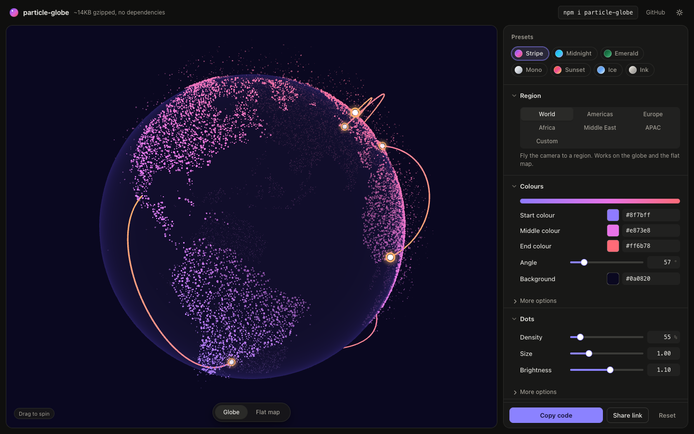
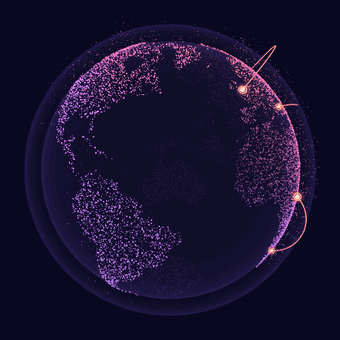

# particle-globe

A tiny particle globe for the web: land as glowing dots, particles, arcs between places, region focus, and a morph to a flat Mercator map. Plain WebGL, no dependencies.

Demo and customiser: https://globe.mickydollimore.com/





## Install

```sh
npm install particle-globe
pnpm add particle-globe
yarn add particle-globe
bun add particle-globe
```

## Quick start

```ts
import { createParticleGlobe } from "particle-globe"

const stage = document.querySelector<HTMLElement>("#stage")! // give it a size, a square works best
const globe = createParticleGlobe(stage, {
  colors: ["#6b54f5", "#db61db", "#eb4d54"],
  rotation: { speed: 0.05 },
})

globe?.update({ flat: 1 })            // animate to the flat map
globe?.update({ focus: "europe" })    // fly the camera to a region
globe?.destroy()                      // when you are done
```

`createParticleGlobe` returns `null` if the browser has no WebGL, and on the server.

## Frameworks

Four ways in. All of them use the same core, so you pay for it once.

| Import | What it is | Extra size (gzip) |
|---|---|---|
| `particle-globe` | The function above. Works anywhere | core |
| `particle-globe/element` | A `<particle-globe>` custom element | 1.4 KB |
| `particle-globe/react` | A React 19 component, Next.js App Router ready | 0.5 KB |
| `particle-globe/astro` | An Astro component that wraps the element | none, it is a source file |

### Vite or plain HTML

```html
<particle-globe style="width: 480px; height: 480px" focus="europe" colors="#6b54f5,#db61db,#eb4d54"></particle-globe>
<script type="module">
  import "particle-globe/element"
</script>
```

Simple options are attributes (`flat`, `focus`, `colors`, `dots-size`, `rotation-speed`, `drag="false"`, and so on, in kebab case). For anything else set the `options` property, or put JSON in an `options` attribute. Removing an attribute puts that option back to its default. The element fires a `ready` event and exposes the running globe as `element.globe`.

```js
document.querySelector("particle-globe").options = { arcs: { labels: true } }
```

This is also the way in for Vue, Svelte and Solid. In Vue, tell the compiler the tag is a custom element (`isCustomElement: (tag) => tag === "particle-globe"`) and pass objects with `:options.prop="opts"`.

### React and Next.js

```tsx
import { ParticleGlobe } from "particle-globe/react"

export default function Page() {
  return <ParticleGlobe style={{ width: 480, height: 480 }} focus="europe" colors={["#6b54f5", "#db61db", "#eb4d54"]} />
}
```

Every option is a prop, plus `className`, `style` and any `div` attribute. The globe is created on mount, `update()` runs when props change (it is not recreated), and it is destroyed on unmount. A prop you remove goes back to its default. Pass `ref` for the instance (React 19 takes `ref` as a normal prop):

```tsx
const ref = useRef<ParticleGlobeInstance | null>(null)
<ParticleGlobe ref={ref} flat={1} />
```

The entry starts with `"use client"`, so you can render it from a Server Component in the App Router with no wrapper. React is an optional peer dependency (`react >= 19`); nothing else is installed.

### Astro

```astro
---
import ParticleGlobe from "particle-globe/astro"
---
<ParticleGlobe class="globe" focus="europe" colors={["#6b54f5", "#db61db", "#eb4d54"]} />
<style is:global>.globe { display: block; width: 480px; height: 480px }</style>
```

Props are the options, as plain data (no functions). Astro bundles the script once however many globes are on the page.

## Options

Pass any subset. Bad values (NaN, a wrong type, a colour that does not parse) are ignored and the previous value stays. Groups (`dots`, `rotation`, `rim`, `globe`, `particles`, `atmosphere`, `arcs`) take partial objects and are merged over the defaults. Ranges are the intended range, not enforced clamps.

| Option | Type | Default | Range / notes |
|---|---|---|---|
| `colors` | `[string, string, string]` | `["#6b54f5", "#db61db", "#eb4d54"]` | Dot gradient: start, middle, end. Any CSS colour |
| `gradientAngle` | `number` | `57` | Degrees across the screen |
| `gradientMid` | `number` | `0.55` | 0.1 to 0.9 |
| `dots.intensity` | `number` | `1` | 0 to 2 |
| `dots.size` | `number` | `1` | 0.1 to 4. Below 1 the dots turn soft; very small ones are held at about 1.8 px, fainter |
| `dots.sizeVariation` | `number` | `1` | 0 to 2.5 |
| `dots.density` | `number` | `0.55` | 0.05 to 5. 1 is the default set of dots; above 1 adds more (5 is five times as many) |
| `dots.twinkle` | `number` | `0.28` | 0 (off) to 1 |
| `dots.highlight` | `number` | `0.78` | 0 (off) to 1 |
| `dots.farSide` | `number` | `0` | 0 (hidden) to 1 |
| `particles` | `false` or object | object below | `false` turns particles off |
| `particles.amount` | `number` | `0.4` | 0.02 to 1 |
| `particles.size` | `number` | `0.9` | |
| `particles.rise` | `number` | `0.14` | 0.02 to 0.5 |
| `particles.drift` | `number` | `0.06` | 0 to 0.4 |
| `particles.speed` | `number` | `0.22` | 0.03 to 1 |
| `particles.opacity` | `number` | `0.6` | |
| `atmosphere` | `false` or object | `false` | Off by default. Passing an object turns it on |
| `atmosphere.color` | `string` | `"#9e94ff"` | Used when switched on |
| `atmosphere.strength` | `number` | `0.16` | 0 to 1 |
| `atmosphere.size` | `number` | `1.12` | 1.02 to 1.5, relative to the globe |
| `rim.color` | `string` | `"#edebff"` | Edge highlight |
| `rim.strength` | `number` | `1` | |
| `globe.fill` | `string` | `"#ffffff"` | The sphere under the dots |
| `globe.fillOpacity` | `number` | `0.96` | |
| `background` | `string` | `"transparent"` | Stage background colour |
| `arcs` | `false` or object | object below | `false` turns arcs off |
| `arcs.routes` | `ArcRoute[]` | 20 sample routes | See route format below |
| `arcs.colors` | `[string, string]` | `["#f25c85", "#fa8c5c"]` | Start and end colour of each arc |
| `arcs.opacity` | `number` | `0.95` | |
| `arcs.thickness` | `number` | `0.0042` | 0.001 to 0.012 |
| `arcs.height` | `number` | `0.42` | 0.1 to 1, relative to distance |
| `arcs.speed` | `number` | `1` | Speed multiplier |
| `arcs.rings` | `boolean` | `true` | Rings at each end |
| `arcs.ringSize` | `number` | `1` | Size multiplier for the endpoint rings |
| `arcs.labels` | `boolean` | `false` | Show route labels at the destination |
| `rotation.auto` | `boolean` | `true` | |
| `rotation.speed` | `number` | `0.035` | Radians per second |
| `rotation.direction` | `1 or -1` | `1` | 1 spins left to right |
| `rotation.startLongitude` | `number` | `-55` | -180 to 180. Longitude facing the viewer on the globe |
| `rotation.tilt` | `number` | `0.32` | -1 to 1 |
| `flat` | `number` | `0` | 0 is the globe, 1 is a flat Mercator map, between morphs |
| `flatCentre` | `number` | `10` | -180 to 180. Longitude at the centre of the flat map; the map wraps at the opposite side |
| `flatTransition` | `number` | `1200` | Milliseconds a change to `flat` animates. 0 jumps |
| `focus` | `Focus` or `null` | `null` | Fly the camera to a region: `"world"`, `"americas"`, `"europe"`, `"africa"`, `"middleEast"`, `"apac"`, or `{ lat, lon, zoom }` (zoom 1 is the whole world, up to 16). `null` is the free globe. Works on the globe and the flat map. Dragging is off while focused |
| `focusTransition` | `number` | `1600` | Milliseconds a change to `focus` animates. 0 jumps |
| `draggable` | `boolean` | `true` | Drag to spin |
| `pauseOffscreen` | `boolean` | `true` | Pause rendering while off screen |
| `respectReducedMotion` | `boolean` | `true` | Hold still for reduced motion |
| `maxPixelRatio` | `number` | `2` | Upper bound for canvas pixel ratio |
| `onReady` | `() => void` | none | Called once the first frame is on screen |

Turn a group off with `false`, back on by passing an object:

```ts
globe.update({ particles: false, arcs: false })
globe.update({ atmosphere: { color: "#9e94ff" } })
```

### Arc routes

Each route is `{ from: [lat, lon], to: [lat, lon], label?: string }`. Latitude and longitude are in degrees. `label` shows at the destination when `arcs.labels` is on.

```ts
createParticleGlobe(stage, {
  arcs: {
    labels: true,
    routes: [
      { from: [51.5, -0.12], to: [40.71, -74.0], label: "New York" },
      { from: [35.68, 139.69], to: [1.35, 103.82], label: "Singapore" },
    ],
  },
})
```

The defaults are exported as `DEFAULT_OPTIONS` and `DEFAULT_ROUTES`, and the region definitions as `REGIONS`. Types: `GlobeOptions`, `GlobeInput`, `ParticleGlobe`, `ArcRoute`, `LatLon`, `Focus`, `RegionName`.

## Handle

`createParticleGlobe(stage, options?)` returns:

- `update(input)` changes any options. Only what you pass changes.
- `resize()` re-measures the stage. It also happens on its own when the stage resizes.
- `destroy()` stops rendering and frees every GPU resource, listener, observer and DOM node it added (the canvas, the label layer, and the injected style once the last globe is gone).
- `options` is the read-only set of options in effect now.

## Performance and size

| Entry | Raw | Gzip | Brotli |
|---|---|---|---|
| `particle-globe` (core, with the land data) | 30.8 KB | 14.2 KB | 12.6 KB |
| `particle-globe/element` | 3.1 KB | 1.4 KB | 1.2 KB |
| `particle-globe/react` | 1.0 KB | 0.5 KB | 0.5 KB |

The wrappers import the core, so a page that uses one pays for the core once. Run `npm run size` to measure it.

- Land is a 5 KB range-coded grid, not a mesh or a texture download.
- Rendering stops while the stage is off screen (`pauseOffscreen`) or the tab is hidden, and holds still for reduced motion (`respectReducedMotion`).
- The canvas pixel ratio is capped at `maxPixelRatio` (2). Lower it, or lower `dots.density` and `particles.amount`, on slow devices.
- Densities above 1 and zoomed regions build extra dots on first use, which takes a moment on a slow machine.

## Browser support

Uses WebGL2 and falls back to WebGL1. If neither exists, `createParticleGlobe` returns `null`, so you can show a fallback. It also returns `null` on the server, and importing any entry on the server is safe.

It handles a lost WebGL context (it comes back on its own), resizes with its stage, follows device pixel ratio changes, and stops drawing while hidden. With `draggable: false` the canvas never takes touch gestures, so the page scrolls normally; with it on, vertical swipes still scroll the page and horizontal drags spin the globe.

Tested in Chrome (WebGL2, and WebGL1 forced). Written to stay inside what Safari and Firefox support, but not yet tested in them.

## Accessibility

The globe is decorative. Mark the stage `aria-hidden="true"` and put any meaningful content in real text next to it.

```html
<div id="stage" aria-hidden="true" style="width: 480px; height: 480px"></div>
```

## Rebuilding the land mask

`src/land-mask.ts` is generated from Natural Earth. To rebuild it, download `ne_50m_land.geojson` from [natural-earth-vector](https://github.com/nvkelso/natural-earth-vector) (`geojson/`), then:

```sh
npm run land -- path/to/ne_50m_land.geojson [cellsPerDegree]
```

The default is 2 cells per degree.

## Development

```sh
npm install
npm run dev          # customiser demo
npm run build        # dist/particle-globe.js and type declarations
npm run build:demo   # demo-dist, for GitHub Pages
npm run size
```

## Credits

Land outlines from [Natural Earth](https://www.naturalearthdata.com) (public domain).

## Licence

MIT. Copyright (c) 2026 Micky Dollimore.
